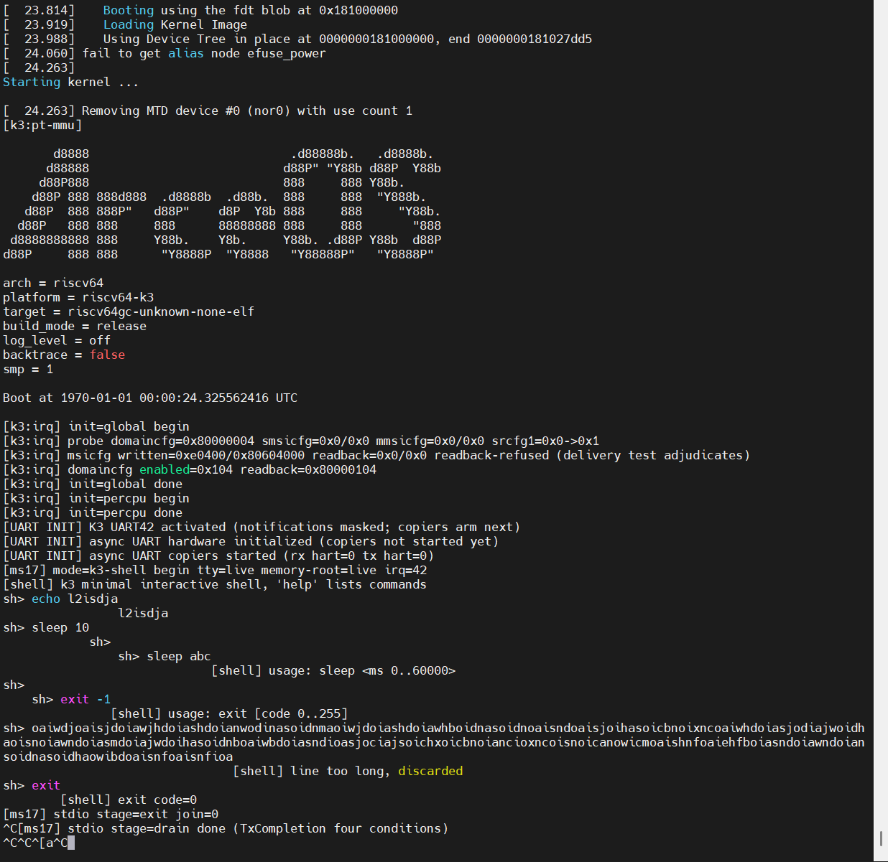

# W16 - K3 真板进入自研异步 shell，正向官方 shell 推进

**周期**：2026-10-03 ~ 2026-10-10
**仓库**：StarryOS（[`daivy2333/StarryOS`](https://github.com/daivy2333/StarryOS)，`k3` 分支，本周 13 个提交）

> 实习收口后的第一周，验证从 QEMU 转到进迭时空 K3 真板（CoM260 Kit）。前半周立起真板基线：RAM 启动可撤销，中断可投递，链路可观测，GMAC 轮询双向打通。10/06 调整顺序，暂停异步网卡、先做串口交互：单核下复用实习的异步串口架构，接 K3 的 PXA UART，补 timer 等待唤醒，向上接通 tty 和内嵌静态 ELF 用户态。10/07 真板进入自研最小 shell（`help`/`echo`/`sleep`/`exit`），两轮交互现场结论“异步串口正常”。当前正在向官方 shell 推进：从 ext4 rootfs 加载 BusyBox 标准 shell，交互仍走这条异步串口链。

## 板级基线

K3 此前只有 QEMU VirtIO 多核的软件结论，真板没有任何平台入口。

| 基线 | 做法与结果 |
|---|---|
| RAM 启动 | FIT 经 U-Boot 装载，可撤销、不写 flash；逐一核对装载地址，展开地址，入口地址，以及 FDT 范围，确认不覆盖固件保留区；外部复位回原系统 |
| 板级事实 | 板载官方 Linux 上跑只读采集程序，回报实际运行 FDT 中的内存、CPU 与 UART/MAC/PHY 资源，冲突字段显式标注，不按默认 DTB 或历史编号补值 |
| 链路观测 | RTL8211F PHY 寄存器与 link 状态可重复读取 |
| 中断投递 | IMSIC 加 APLIC（仅 MSI 模式）底座，`stopei` 单条指令原子 claim+EOI；PHY link-change 中断链 RTL8211F INTN → GPIO35 下降沿 → APLIC source 60，插拔网线可重复触发 |
| 轮询网络 | GMAC DMA descriptor 队列分清 descriptor 与 buffer 所有权，ARP/ICMP/UDP/TCP 双向与宿主机抓包一致 |

## 自研异步 shell

K3 当时的 console 输出逐字节忙等硬件，输入直接返回 0，构建里常规驱动、tty、进程与用户程序加载全部排除。10/06 决定暂停异步网卡（计划保留），先做串口交互：给后续网络开发留一个已验收的 timer/任务底座和交互入口。

链路分四层递进，每层都有真板验收：

1. **timer 与 PXA UART 硬件入口**。单核 scheduler/timer 等待真正可用，timer 与 UART 外部中断互不串路。PXA UART 适配进实习架构的 UartPort：IRQ 42、MMIO 0xd4017000，stride 4，64B FIFO，以及 task-context Errata20 序列。硬中断只确认原因、清中断并唤醒，搬运全在任务上下文。
2. **数据面**。复用 RX/TX copier 与无锁 SPSC 字节 rings（64KiB），覆盖 short write，背压恢复，RX timeout 最后字节，以及四条件物理 drain：软件 ring 空、copier 无 staged 字节，FIFO 与 transmitter 全空。
3. **tty 与用户态**。tty canonical 行输入（ERASE/KILL、1024B 行界）；静态 ELF 内嵌进内核镜像（无 rootfs），stdio/syscall 接通，tty 是唯一输入消费者。
4. **最小 shell**。命令 `help`/`echo`/`sleep`（0..60000 ms）/`exit`；256B 命令缓冲，超长行整行丢弃、不执行截断前缀；读写 EINTR 重试、short write 续写。

单核限定：SMP>1 在构建入口直接拒绝，多 hart 归后续网络阶段一起验收。

### 真板交互

| 场景 | 实测 |
|---|---|
| `help` / `echo` | 完整命令列表输出，文本回显正确 |
| `sleep 10` | 提示符返回，后续命令正常响应 |
| 非法输入 | `ls ./`，`helo`，`sleep abc`，以及 `exit -1`，均给出反馈后回到提示符 |
| 超长行 | 超过 256 字符整行丢弃，截断前缀未执行 |
| 空闲恢复 | 每条命令都在空闲间隔后输入，IRQ 唤醒正常 |
| `exit` | shell 报 exit code=0，内核有界 drain 后停车 |
| Ctrl-C | 结束用户进程，内核侧保持 |
| 复位 | 外部 reset 回原系统 |

现场结论“异步串口正常”，两轮串口原文已存档在 StarryOS 仓库。10/07 当轮的串口照片（release 构建，smp=1，IRQ 42，exit 后 drain 完成）：

host 侧：shell 命令 20 项，uart crate 74 项，tty 11 项，native 测试全过。

## 下一步：官方 shell

正在向官方 shell 推进：从与 QEMU 同源的 ext4 rootfs 加载 BusyBox/musl 标准 `/bin/sh`，用户程序从“内嵌单个 ELF”升级为“从文件系统加载”，交互仍走这条异步串口/tty 链。之后恢复异步网卡计划，串口与网卡一起做多 hart 验收。

## 参考

- [StarryOS（daivy2333/StarryOS）](https://github.com/daivy2333/StarryOS) — `k3` 分支
- [K3 资料仓（daivy2333/k3）](https://github.com/daivy2333/k3)
- [笔记：异步 UART 驱动架构](../notes/异步串口/async-uart-overall-architecture.md)
- 周报 [W15](../weeks/weekly-2026-W15.md)（实习总结）
