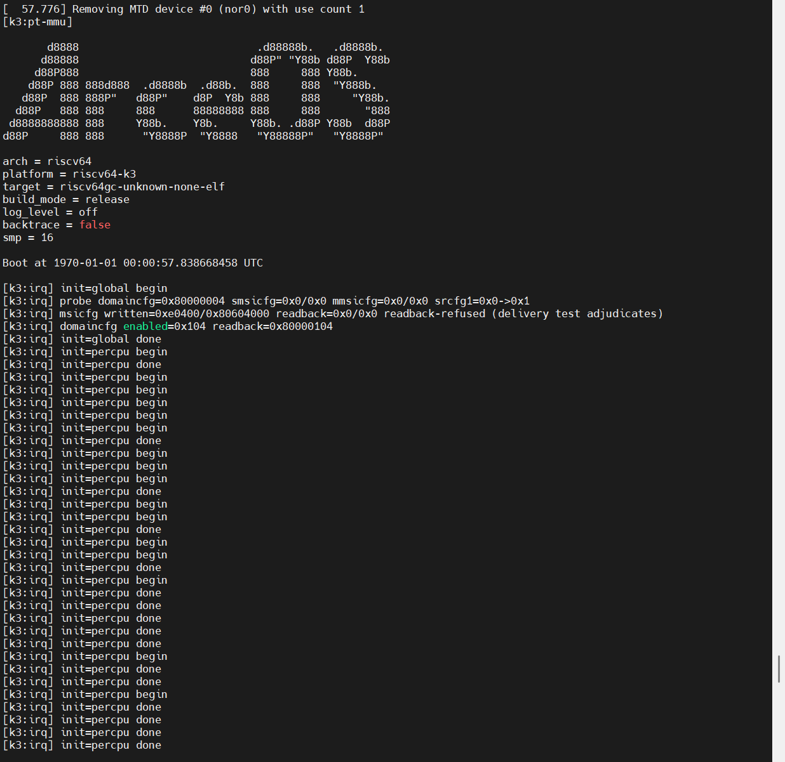
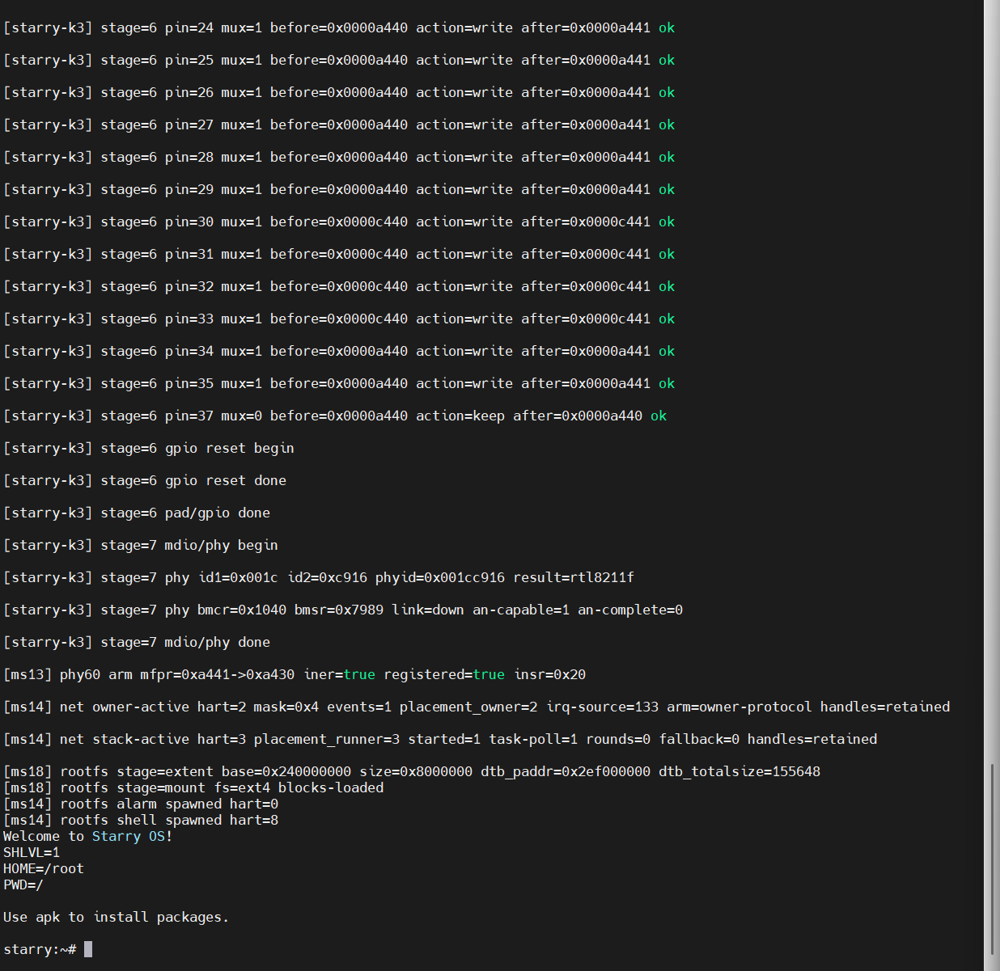
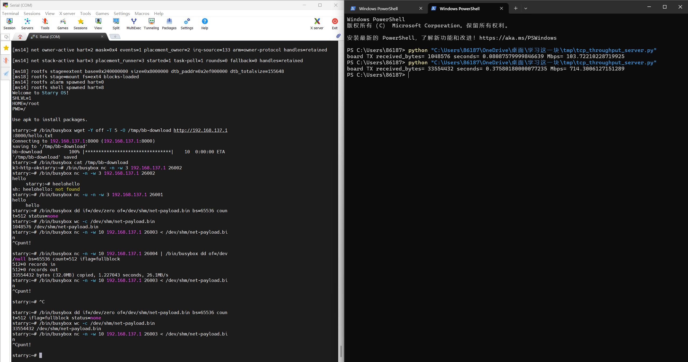
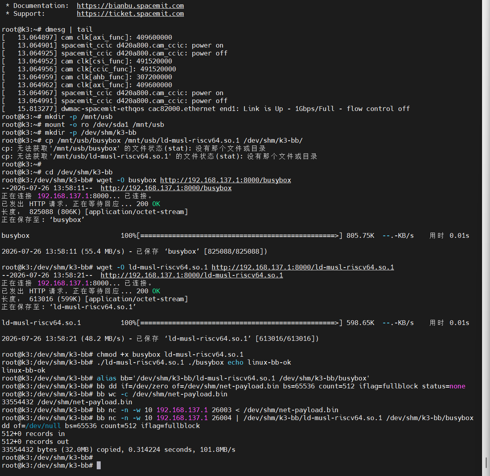

# W17 - 收官周：三连验收后，16 个 hart 的 BusyBox shell 落地

**周期**：2026-10-10 ~ 2026-10-17
**仓库**：StarryOS（[`daivy2333/StarryOS`](https://github.com/daivy2333/StarryOS)，[`k3` 分支](https://github.com/daivy2333/StarryOS/tree/k3)，本周 6 个提交，三个里程碑收尾归档）

> 实习最后一周，进迭时空 K3（CoM260 Kit）四天验收三个里程碑。10-13 的异步数据面把 GMAC 中断接入异步队列/协议栈契约，单 hart IRQ 驱动的双向收发四协议真板通过；10-14 的网络恢复语义收口真实拔插、受控运行时 reset 与新旧对象隔离；10-16 的多 hart 最终验收拉起 16 个 AP hart，交付最终形态——异步串口上跑普通 BusyBox RAM rootfs shell，同一次启动里 `wget`/`nc` 用户态网络走异步 GMAC。真板现场暴露两个产品 bug（shell 提示符前 SIGSEGV、`wget` 的 socket ENOSYS），均修复并板验。TCP 单样本对比原厂 Linux：板→PC 714.3 vs 934.0 Mbps（76.5%），PC→板 218.8 vs 854.3 Mbps（25.6%）。K3 路线图至此全部交付，实习以板子交接和成果汇报收尾。

## 异步双向数据面（10-13 验收）

- GMAC source-133 中断适配到 transport-neutral 队列契约：注册/重臂/重查，无丢唤醒，带 deferred owner 与 fatal latch；硬中断只确认、清中断、唤醒，不推进 descriptor 和协议栈。
- 唯一常驻 queue owner：分阶段 budget，64 slot / 16 descriptor 账本，两级 Full→恢复，ticketed C4 flush（Pending→release→C4）。
- 向上接通 axnet stack runner 与 socket。真板两轮：ping 10/10 ×2，UDP 26001 / TCP 26002 全字节回显，TCP 主动关闭 EOF，快照行齐备。
- quiet 判定：先经 500 ms 沉降相吸收 TCP 关闭尾流，再观察 2 s 窗口，计数逐字节冻结，恢复靠逐包真实中断，全程 [`fallback=0`](https://github.com/daivy2333/StarryOS/blob/42ea95e2/kernel/src/platform/k3_async_net.rs#L1361)。
- 本板事实：quiet 观察窗前必须先沉降，否则关闭尾流会结构性落进窗口；宿主 axhal 无平台后端（`wall_time()≡0`），timer wheel 只有真板/QEMU 上有效。

## 网络恢复语义（10-14 验收）

- 受控恢复矩阵在 [`k3-async`](https://github.com/daivy2333/StarryOS/blob/42ea95e2/Makefile#L339)/[`k3-async-probe`](https://github.com/daivy2333/StarryOS/blob/42ea95e2/Makefile#L349) 独立入口运行：18 页 arena 原地 stop/SWR/重建；QueueEpoch/cookie 隔离新旧对象；旧 socket 收 connection-reset 终态与 flush abort；owner 跨恢复常驻。
- 真实拔插走 source-60：pad35 双沿武装；RTL8211F INTN 是电平型，靠读 INSR 清 pending、owner 读 link 消费 latch，ISR 全程不碰 MDIO。
- 容量第 1 轮 81 帧跨两级边界，C4 flush 成立；恢复后新会话真实逐字节 UDP/TCP 交换。
- 返工轮修复三处：host 尾相 C4 探针补驱动设备半（[`drain_board_tx`](https://github.com/daivy2333/StarryOS/blob/42ea95e2/tests/k3-async-net-host/src/fake.rs#L451) + 发队列事件）；[`wait_lifecycle`](https://github.com/daivy2333/StarryOS/blob/42ea95e2/kernel/src/platform/k3_async_net.rs#L2551) 加离开-再回护栏——陈旧 `Active(2)` 采样是恢复后首帧被拒的确定性根因；恢复门清除移进 Service guard 内、提到 lifecycle 提交之前，消除 [`sched-rr`](https://github.com/daivy2333/StarryOS/blob/42ea95e2/crates/axtask/Cargo.toml#L57) 抢占下的 µs 窗口。
- 按用户收口裁决留档不追：容量/C4 第 2 轮、fail-stop 末场景，有 trace 证据未定位。
- 本板事实：pad35 MFPR 复位即双沿武装，运行时写入幂等。

## 多 hart 异步 I/O 最终验收（10-16）

这个里程碑分五轮推进：前四轮交付多 hart 平台、网卡多 hart 稳态、串口多 hart 交互与 rootfs 双设备组装，最后一轮做最终真用验收与性能测量。

### 16 hart 与固定角色

- SMP=16（SMP=1/17 构建期直接拒绝）；16 个 AP hart（0–15）各有实际调度进度，per-hart timer 加 S_SOFT IPI，固定外设 IRQ 路由；RP/RT24 排除。
- 固定角色：串口 RX=0、TX=1，网卡 owner=2、runner=3，alarm=0，shell=8；网卡应用角色实际落在 2/3/9 号 hart，覆盖 X100/A100 两个簇。

### 最终形态：一次启动，普通 BusyBox shell

[`k3-smp-combined`](https://github.com/daivy2333/StarryOS/blob/42ea95e2/Makefile#L520)：同一份 16-hart RAM/FIT 启动，普通 ext4 RAM rootfs 经普通 loader 起动态 `/bin/sh`。无内嵌 shell 作后备，唯一 tty reader，子任务 spawn 时继承父 cpumask，exec 不改。

### 真用：异步串口与异步 GMAC 同处一个 shell

`wget` 下载 10 字节 `k3-http-ok` 逐字节读回正确；`nc` TCP 26002、UDP 26001 同内容回显；工具退出后 shell 继续响应。全部走用户态 syscall → axnet → GMAC 常驻 owner/runner，串口交互走异步 UART。

### 真板暴露两个产品 bug，均 RED → 修复 → 板验 GREEN

1. **shell 提示符前崩溃。** K3 跨簇取指页故障间歇性交出污染的 `stval`（高位或上 0xffffff0000000000，低位精确），`sepc` 始终正确；handler 解析失败 → SIGSEGV，exit 139，零输出。FS loader 的 exec 段是唯一能懒填充的路径——嵌入式 loader 和堆路径本来 eager，单 hart shell 因此没遇到。修复：[`map_elf`](https://github.com/daivy2333/StarryOS/blob/42ea95e2/kernel/src/mm/loader.rs#L83) 段映射改 `populate: true`，装载 hart 在 exec 前完成文件填充与 BSS 零填，COW 写语义保留；只动 [`kernel/src/mm/loader.rs`](https://github.com/daivy2333/StarryOS/blob/42ea95e2/kernel/src/mm/loader.rs)。
2. **`wget` 在 `socket()` 返回 ENOSYS。** 用户态网络 syscall 家族与 Socket 文件包装自仓库初始化提交起对一切 K3/D1 形状编译排除——当时 K3 还没有网络栈；此前网络的测试载荷从内核态任务直用 axnet，K3 用户 socket 路径从未被行使。修复：编译门收窄为仅 [`k3-smp-combined`](https://github.com/daivy2333/StarryOS/blob/42ea95e2/kernel/Cargo.toml#L109) 开启（[`kernel/src/syscall/mod.rs`](https://github.com/daivy2333/StarryOS/blob/42ea95e2/kernel/src/syscall/mod.rs) 18 处、[`kernel/src/file/mod.rs`](https://github.com/daivy2333/StarryOS/blob/42ea95e2/kernel/src/file/mod.rs) 2 处）；`k3-rootfs`/`k3-smp*`/D1 保持关闭——k3-rootfs 无网卡，socket 不得达 axnet；QEMU/VF2 不变。

修复板验：#1 在 LOG=info 诊断轮看到提示符、`ls`/`cd` 正常、applet 子进程 exit 0、SIGINT 后提示符仍正常；#2 在 LOG=off 交付镜像上 wget/nc/shell 全绿。

### TCP 吞吐对比原厂 Linux

同一板口、网线、PC 网卡；原厂 Linux 跑从 rootfs 镜像导出的同一份 BusyBox + musl loader（经 HTTP 部署到 `/dev/shm`）。单 TCP 连接、32 MiB、接收端计时，每方向 1 个样本——用户裁决不做多次采样。

| 方向 | StarryOS | 原厂 Linux | 比例 |
|---|---|---|---|
| 板→PC | 714.3 Mbps（0.3758 s） | 934.0 Mbps（0.2874 s） | 76.5% |
| PC→板 | 218.8 Mbps（1.2270 s） | 854.3 Mbps（0.3142 s） | 25.6% |

两侧 dmesg 均记录链路 1 Gbps/Full。两系统默认配置不同（调度、offload、协议栈、缓冲），这是整条路径的对比，不能归因为纯驱动收益；本轮未调优，单样本也不下性能结论。

## 实习收尾

K3 路线图全部做完：板级基线 → 中断底座 → 轮询网络 → 异步数据面 → 恢复语义 → 交互 shell → RAM rootfs → 多 hart 最终验收。

终于，我的实习也马上要结束了，剩下的时间做不出什么东西，看到网卡成功运行当然是高兴的，但是那个差距又让人失望，或许应该和starryos原本的网卡比才公平，或许我更应该在意输入输出的差距，这里我本想继续定位问题，找出输入缓慢的原因，但是时间不多，板子也要还回去，那就这样吧，留作后来人优化的地方。

然后就是到离22号还有几天，有几天的时间可以收尾却又不够继续多做一些有阶段的工作，不如整理一下仓库，清理一下没用到的死代码，然后整理一下文档，尤其是k3板子相关的内容，我会整理到我那个放官方信息的仓库里面，这样下一个来进行实习的兄弟应该就不用做这些重复性的工作了。

## 参考

- [StarryOS（daivy2333/StarryOS）](https://github.com/daivy2333/StarryOS) — `k3` 分支
- [K3 资料仓（daivy2333/k3）](https://github.com/daivy2333/k3)
- 周报 [W16](../weeks/weekly-2026-W16.md)（K3 首个 shell 会话）
- 周报 [W15](../weeks/weekly-2026-W15.md)（实习总结）
